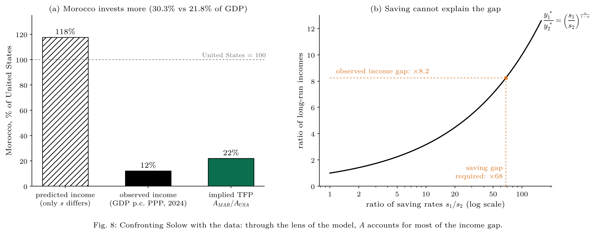
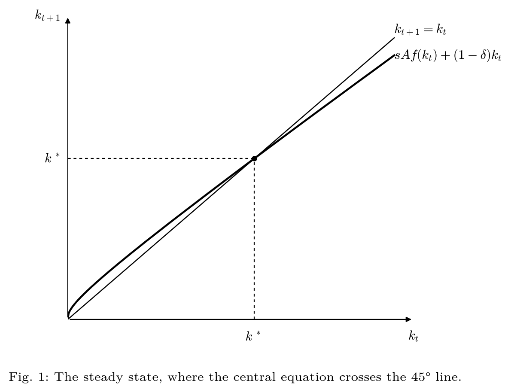
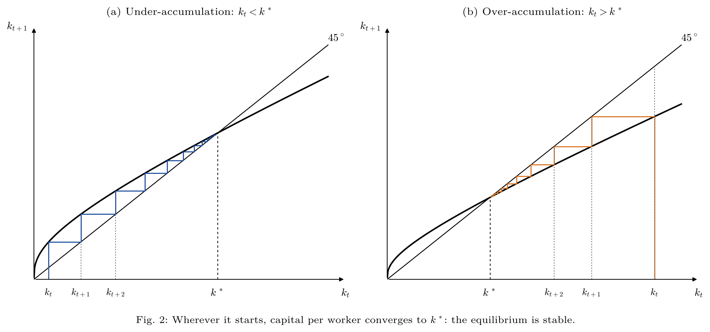
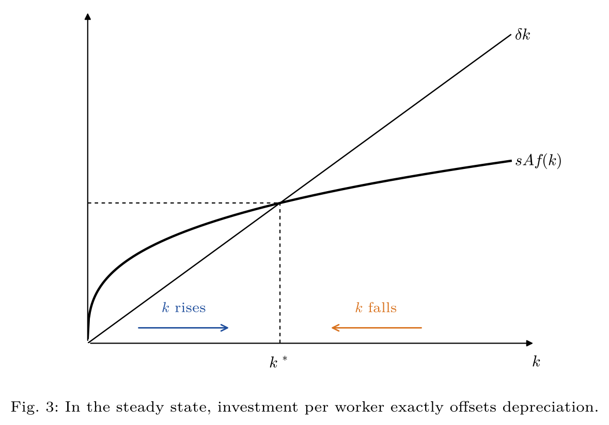
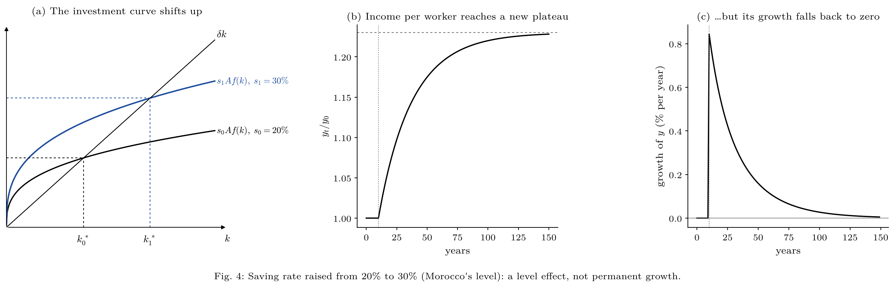
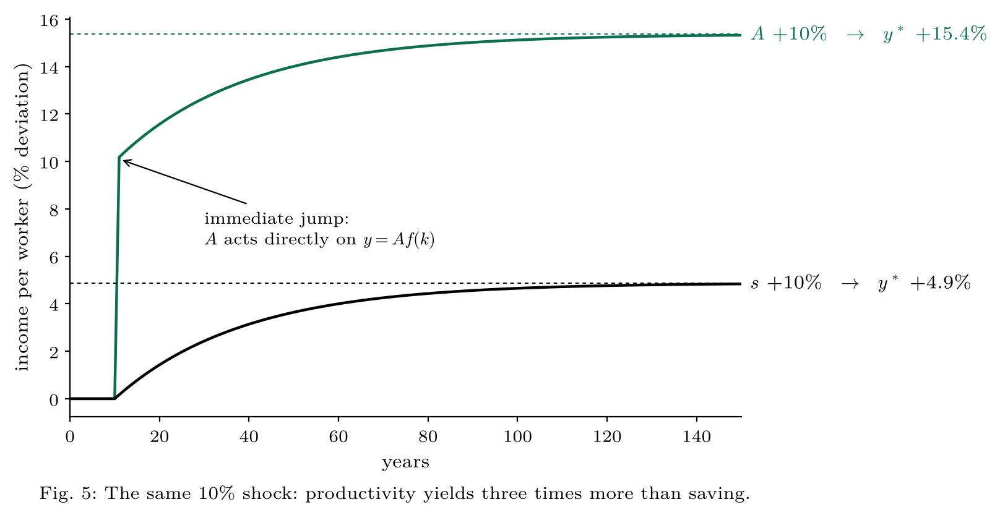
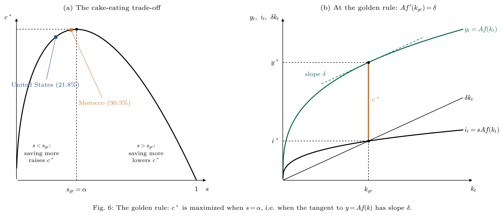
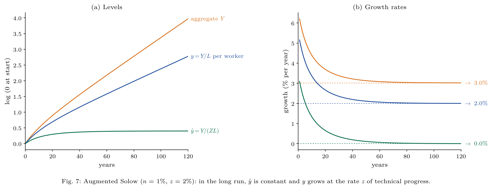

# The Solow Growth Model Applied to Morocco

A Python simulation of the Solow (1956) growth model, confronted with Moroccan and US data.
Built as an applied companion to an intermediate macroeconomics course (growth theory chapter).

> **Key finding.** Morocco invests 30.3% of its GDP, against 21.8% for the United States.
> If the saving rate were all that mattered, Solow predicts Morocco should be **18% richer** than the United States.
> In reality, its GDP per capita (PPP) is only **12%** of the US level. Through the lens of the model,
> total factor productivity (A) accounts for most of the gap: Morocco's TFP would be about **22%** of the US level.



---

## The model

Three building blocks, with Cobb-Douglas production:

| Block | Equation |
|---|---|
| Production | $Y_t = A K_t^{\alpha} L_t^{1-\alpha}$ |
| Capital accumulation | $K_{t+1} = I_t + (1-\delta) K_t$ |
| Saving | $I_t = s Y_t$ |

In per-worker terms, this gives the **central equation**:

$$k_{t+1} = s A k_t^{\alpha} + (1-\delta) k_t$$

and the steady state:

$$k^* = \left(\frac{sA}{\delta}\right)^{\frac{1}{1-\alpha}}, \qquad y^* = A^{\frac{1}{1-\alpha}} \left(\frac{s}{\delta}\right)^{\frac{\alpha}{1-\alpha}}, \qquad c^* = (1-s)\,y^*$$

The script checks that the numerical simulation converges to these closed-form solutions.

**Calibration:** $\alpha = 1/3$ (capital share), $\delta = 5\%$ per year, $s$ = average observed investment rate over 2018–2024.

---

## Figures

### 1. The steady state


### 2. Dynamics: under- and over-accumulation
Wherever the economy starts, capital per worker converges to $k^*$: the equilibrium is stable.


### 3. Investment vs depreciation


### 4. A higher saving rate: a level effect
Raising the saving rate from 20% to 30% lifts long-run income by 23%, but growth falls back to zero.


### 5. Saving or productivity?
The same 10% shock: A raises output directly **and** through capital accumulation, hence an effect three times larger.


### 6. The golden rule
Long-run consumption is maximized when $Af'(k_{gr}) = \delta$, i.e. $s_{gr} = \alpha$.


### 7. The augmented Solow model
With population growth (n) and labor-augmenting technical progress (z), income per worker grows at rate z in the long run.


### 8. Confronting the data
With $\alpha = 1/3$, $y^* \propto s^{1/2}$: explaining an income gap of 1 to 8.2 would require a saving-rate gap of 1 to 68.

---

## Run it

```bash
pip install -r requirements.txt
python solow.py
```

Figures are saved in `figures/` as PDF (vector) and PNG. `solow_figures.pdf` gathers all of them.

## Structure

```
modele-solow/
├── solow.py                  # model, simulations and figures
├── data/morocco_usa_data.csv
├── figures/                  # 8 figures (PDF + PNG)
├── solow_figures.pdf         # all figures in one file
└── requirements.txt
```

## Data

| Variable | Source |
|---|---|
| Gross capital formation (% of GDP), 2018–2024 | World Bank, World Development Indicators (NE.GDI.TOTL.ZS) |
| GDP per capita, PPP, 2024 | World Bank, World Development Indicators |

## Limitations

- The model describes a **closed economy**: the investment rate is used as a proxy for the saving rate, although Morocco partly finances its investment from abroad.
- $\alpha$ and $\delta$ are assumed to be **identical** across countries.
- TFP is computed as a **residual**: it measures our ignorance as much as efficiency.
- The comparison is between steady states, while both economies may still be in transition.

## Next steps

- Test absolute vs conditional convergence and convergence clubs with the Penn World Tables.
- Compute the Solow residual for Morocco over a long period.
- Link TFP to economic complexity (Hausmann): see [Development-Beyond-Industrialization](https://github.com/Imrane-Alami/Development-Beyond-Industrialization-Testing-Rodrik-and-Hausmann-with-Cross-Country-Data).

## Reference

Garín, J., Lester, R. and Sims, E., *Intermediate Macroeconomics*, chapters 5–7.
